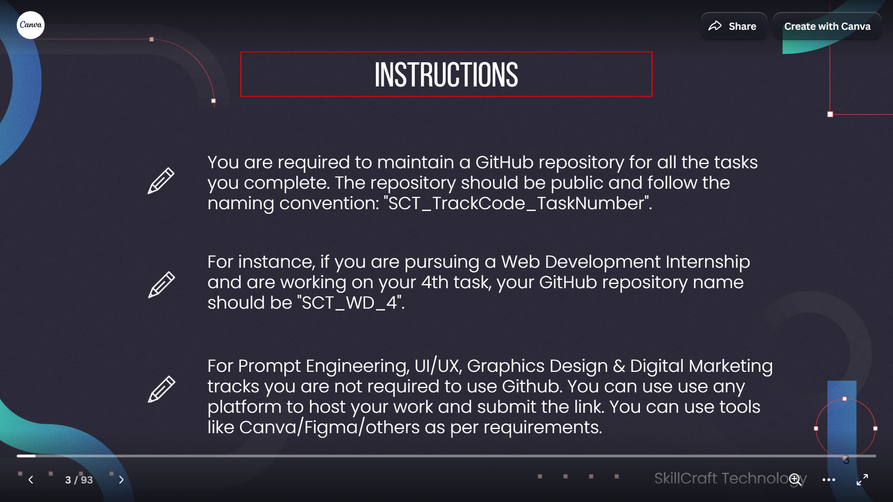
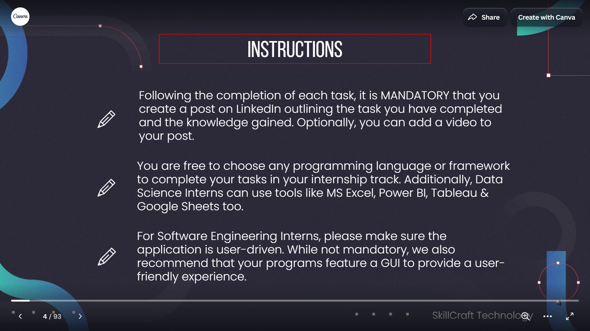
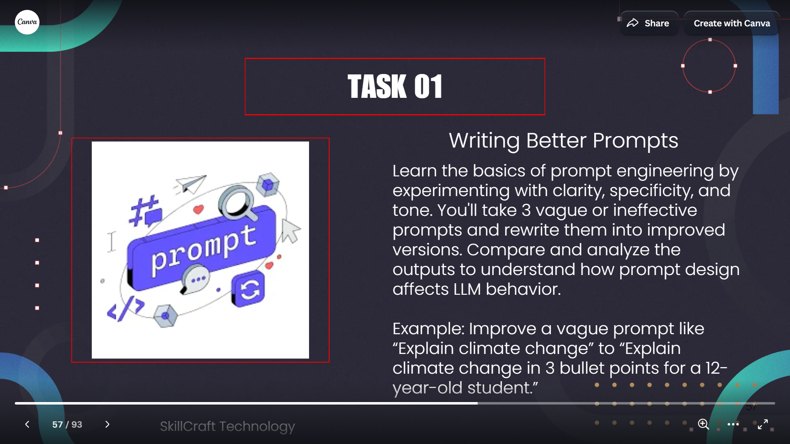
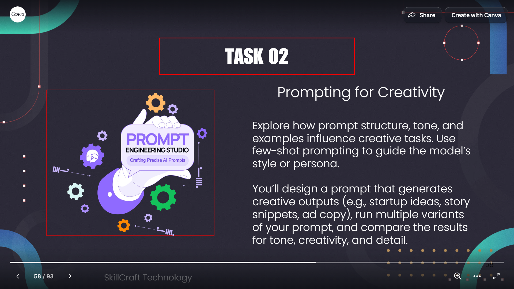
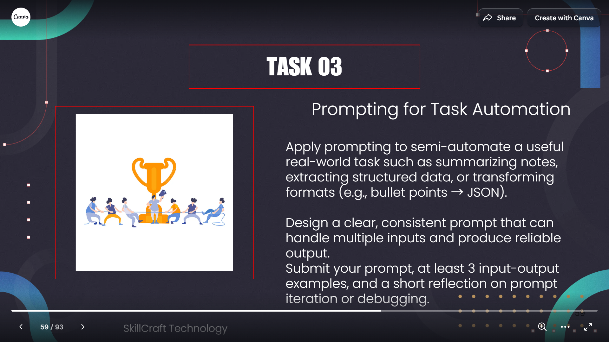
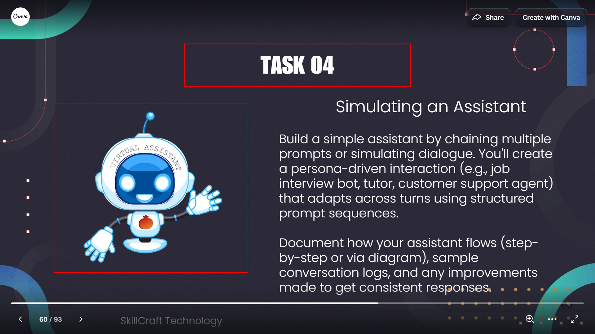

# Official Task Brief (Prompt Engineering track)

**Source:** SkillCraft Technology, *Task List Document*, a 93-page Canva presentation
(<https://www.canva.com/design/DAGm3L3vZeM/1Cl4W1rotDufDQwCNEbf7w/view>).

**How it was retrieved:** the page was opened in a headless browser (Playwright) on
2026-10-22. The visible text of every page was extracted, and the pages relevant to this
track were screenshotted. The text below is copied verbatim from the extraction. The
screenshots are in this folder. Pages 56–60 are the Prompt Engineering (track code **PE**)
section. Pages 2–4 hold the general instructions that apply to every track.

## General instructions (pages 2–4)

> You should only start completing you tasks after your internship begins. The start date
> will be mentioned in your Offer Letter Mail.
>
> To be eligible for the Completion Certificate, it is mandatory for you to complete at least
> 2 Tasks in your internship track. To obtain a LoR, you need to complete all 4 tasks.
>
> You are free to select your own learning resources to study and complete the tasks, as no
> training will be provided during the internship. Also, the internship is completely
> self-paced and thus there are no fixed timings.

> You are required to maintain a GitHub repository for all the tasks you complete. The
> repository should be public and follow the naming convention: "SCT_TrackCode_TaskNumber".
>
> For instance, if you are pursuing a Web Development Internship and are working on your 4th
> task, your GitHub repository name should be "SCT_WD_4".
>
> For Prompt Engineering, UI/UX, Graphics Design & Digital Marketing tracks you are not
> required to use Github. You can use use any platform to host your work and submit the link.
> You can use tools like Canva/Figma/others as per requirements.

> You are free to choose any programming language or framework to complete your tasks in your
> internship track. […]
>
> Following the completion of each task, it is MANDATORY that you create a post on LinkedIn
> outlining the task you have completed and the knowledge gained. Optionally, you can add a
> video to your post.

## Task 01 — Writing Better Prompts (page 57)

> Learn the basics of prompt engineering by experimenting with clarity, specificity, and tone.
> You'll take 3 vague or ineffective prompts and rewrite them into improved versions. Compare
> and analyze the outputs to understand how prompt design affects LLM behavior.
>
> Example: Improve a vague prompt like "Explain climate change" to "Explain climate change in
> 3 bullet points for a 12-year-old student."

## Task 02 — Prompting for Creativity (page 58)

> Explore how prompt structure, tone, and examples influence creative tasks. Use few-shot
> prompting to guide the model's style or persona.
>
> You'll design a prompt that generates creative outputs (e.g., startup ideas, story snippets,
> ad copy), run multiple variants of your prompt, and compare the results for tone,
> creativity, and detail.

## Task 03 — Prompting for Task Automation (page 59)

> Apply prompting to semi-automate a useful real-world task such as summarizing notes,
> extracting structured data, or transforming formats (e.g., bullet points → JSON).
>
> Design a clear, consistent prompt that can handle multiple inputs and produce reliable
> output.
>
> Submit your prompt, at least 3 input-output examples, and a short reflection on prompt
> iteration or debugging.

## Task 04 — Simulating an Assistant (page 60)

> Build a simple assistant by chaining multiple prompts or simulating dialogue. You'll create
> a persona-driven interaction (e.g., job interview bot, tutor, customer support agent) that
> adapts across turns using structured prompt sequences.
>
> Document how your assistant flows (step-by-step or via diagram), sample conversation logs,
> and any improvements made to get consistent responses.

## What the brief does not specify

The slides give no grading rubric, no word or page limits, no required model, no file
format, and no submission deadline. Any evaluation criteria in this repository beyond
"tone, creativity, and detail" (Task 2) were chosen by the author and are documented in
[../methodology.md](../methodology.md).
